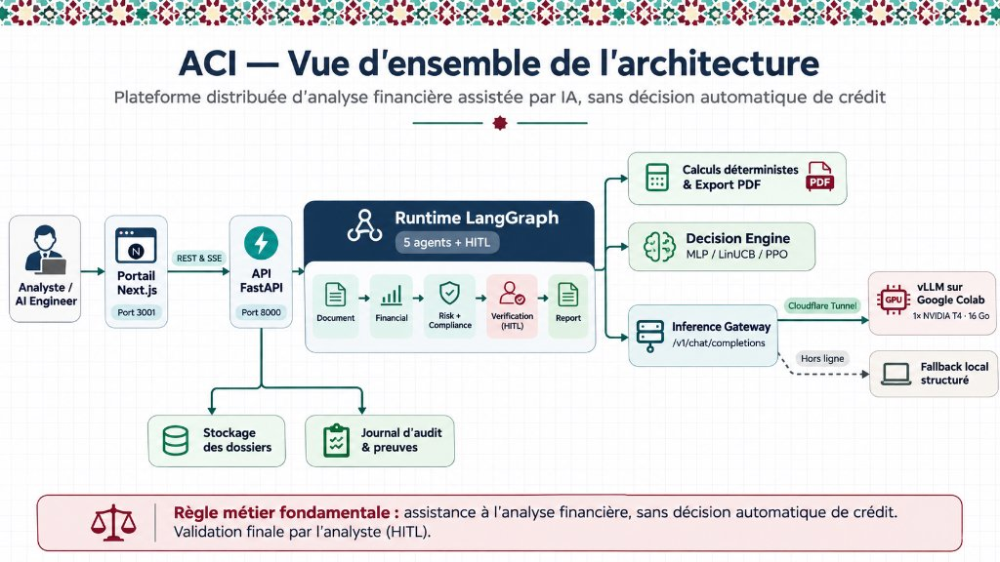
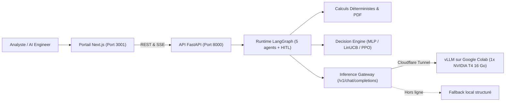
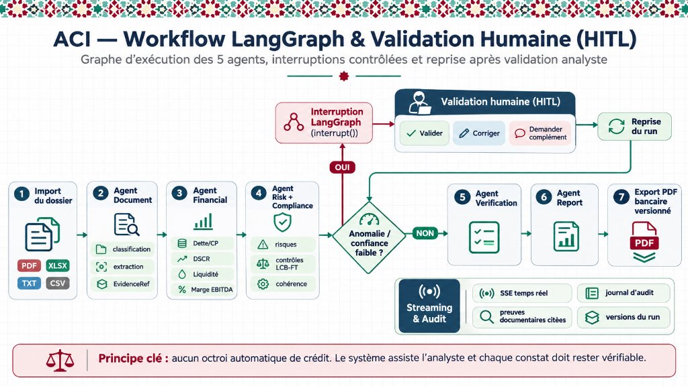
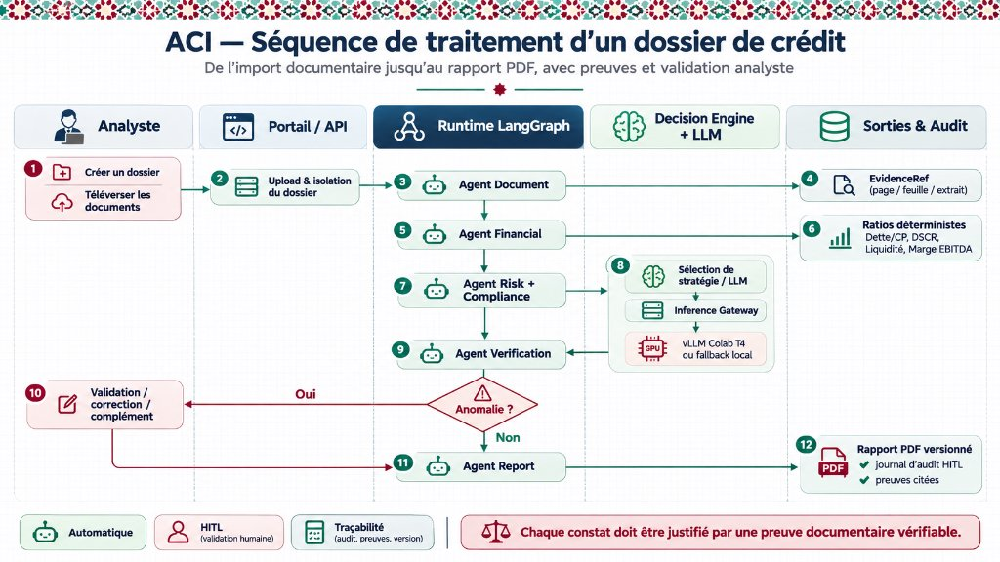
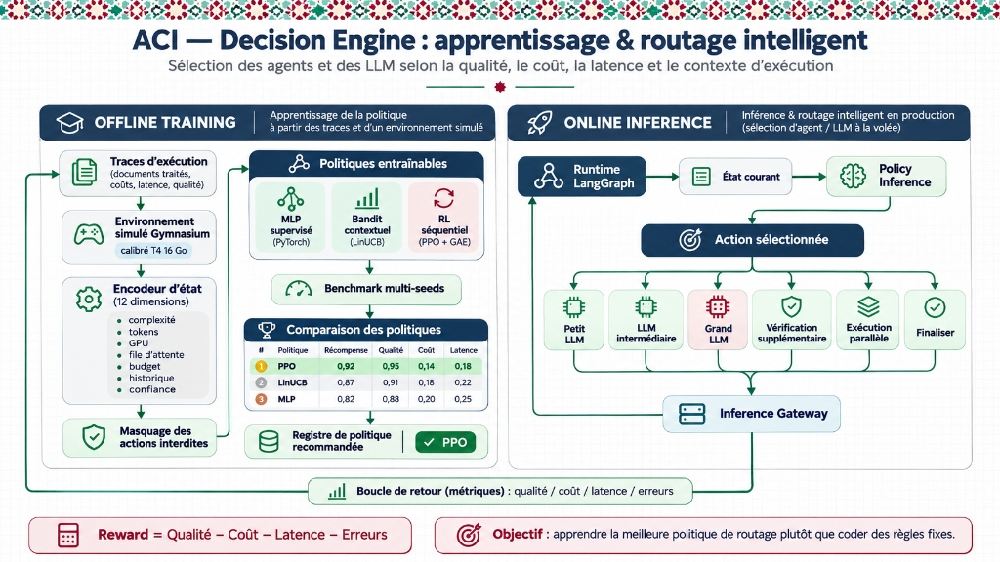

<div align="center">


# Agentic Credit Intelligence (ACI)

**Plateforme distribuée d'analyse financière d'entreprises & d'optimisation d'agents IA par apprentissage automatique et renforcement.**

[](pyproject.toml)
[](services/api/app.py)
[](services/runtime/graph.py)
[](intelligence/reinforcement_learning/ppo.py)
[](apps/analyst-portal)
[](infrastructure/colab/aci_vllm_t4_server.ipynb)
[](tests)

[Architecture](#-architecture-globale) · [Workflow & HITL](#-workflow-langgraph--validation-humaine-hitl) · [Decision Engine](#-decision-engine--apprentissage--routage-intelligent) · [Benchmarks](#-résultats-du-benchmark-t4-16-go) · [Démarrage rapide](#-démarrage-rapide) · [API](#-contrats-api)

</div>

---

> [!IMPORTANT]
> **Gouvernance & Périmètre Métier** — ACI est conçu exclusivement comme un système d'**assistance à l'analyse financière**, **sans aucune décision automatique d'octroi ou de refus de crédit**. Tous les calculs sont strictement déterministes, chaque constat cite une preuve documentaire vérifiable (`EvidenceRef`) et la validation finale appartient à l'analyste.

---

## Pourquoi ACI ?

| Défi métier (Banque Entreprise) | Défi d'ingénierie IA | Réponse ACI |
| :--- | :--- | :--- |
| Dossiers hétérogènes (PDF, Excel, relevés) longs à instruire et à justifier | L'exécution multi-agents naïve est coûteuse, lente et imprévisible en VRAM | **Routage intelligent entraînable** (MLP, LinUCB, PPO) calibré sur **NVIDIA T4 16 Go** |
| Risque d'hallucination numérique ou d'incohérence entre bilan et dettes | Les LLM ne doivent jamais calculer de ratios financiers critiques | **Moteur financier 100 % déterministe** + **contrôles bloquants F05** + **reprise HITL** |
| Exigences strictes d'auditabilité et de traçabilité bancaire | Traces dispersées entre prompts, modèles et décisions humaines | **Contrats Pydantic**, **journal HITL**, **streaming SSE** et **export PDF versionné** |

---

## Architecture Globale

ACI repose sur une architecture hybride modulaire : l'applicatif, l'orchestration LangGraph et le Decision Engine s'exécutent localement, tandis que l'inférence LLM est déportée sur **vLLM (Google Colab 1× NVIDIA T4 16 Go)** via tunnel HTTPS Cloudflare — avec bascule automatique sur un fallback local structuré hors ligne.

<div align="center">
  
</div>

<details>
<summary><strong>Voir le schéma Mermaid & l'arborescence complète du dépôt</strong></summary>



```text
ACI/
├── apps/analyst-portal/          # Portail Next.js 15 (6 vues, upload PDF/Excel, export PDF)
├── services/
│   ├── contracts/                # Contrats Pydantic partagés (métier, RL, inférence)
│   ├── api/                      # API FastAPI métier + upload + PDF + SSE
│   ├── runtime/                  # Orchestration LangGraph, MemorySaver, interrupt() HITL
│   ├── router/                   # Decision Engine (/router/predict, /training/jobs)
│   └── inference/                # Inference Gateway OpenAI-compatible (T4 + quotas + fallback)
├── agents/
│   ├── document/                 # Parseur PDF / Excel / TXT & extraction sourcée (F01/F02)
│   ├── financial/                # Moteur de calculs déterministes & contrôles (F03/F05)
│   └── report/                   # Générateur PDF bancaire versionné ReportLab (F06)
├── intelligence/
│   ├── decision_model/           # Encodeur 12D, masquage d'actions, MLP PyTorch & LinUCB
│   └── reinforcement_learning/   # Simulateur Gymnasium T4 & entraîneur PPO PyTorch
├── datasets/synthetic/           # Générateur reproductible de dossiers annotés
├── benchmarks/                   # Protocole expérimental multi-seeds & rapports
├── infrastructure/colab/         # Notebook vLLM optimisé 1x NVIDIA T4 (FP16 + AWQ)
├── tests/                        # Suite pytest complète (26 tests)
└── docs/                         # Architecture détaillée & diagrammes Mermaid
```

</details>

---

## Workflow LangGraph & Validation Humaine (HITL)

Le graphe d'exécution enchaîne 5 agents spécialisés. **Le routeur ne peut jamais contourner les calculs déterministes ni les vérifications bloquantes.** Toute anomalie (ex. écart entre la dette au bilan et `Dettes.xlsx`, ou confiance d'extraction insuffisante) déclenche une suspension native `interrupt()`, permettant à l'analyste de corriger ou confirmer avant reprise et génération du rapport PDF.

<div align="center">
  
</div>

### Séquence complète de traitement d'un dossier

<div align="center">
  
</div>

---

## Decision Engine : Apprentissage & Routage Intelligent

Plutôt que de figer un unique modèle coûteux pour chaque tâche, ACI modélise le choix des ressources d'exécution (`small` / `medium` / `large`) comme un problème de décision séquentiel sous contraintes de sécurité et de VRAM T4 :

- **Observation normalisée (`s`, 12 dimensions)** : type de tâche, taille du contexte, complexité estimée, charge GPU, VRAM T4, file d'attente, budget résiduel, étape, confiance précédente.
- **Masquage strict des actions interdites** : `small` interdit sur tâche critique complexe (`>= 0,80`), `large` interdit si `VRAM >= 90 %` ou `budget < 0,05 $`.
- **Reward composite** : `R = 0,60 · Qualité − 0,15 · Coût − 0,15 · Latence − 0,10 · Erreurs`.

<div align="center">
  
</div>

---

## Résultats du Benchmark (T4 16 Go)

Protocole reproductible sur **3 seeds (`42, 101, 202`)**, simulateur Gymnasium calibré **NVIDIA T4 (16 Go)** (`Qwen2.5-3B/7B/14B-Instruct-AWQ`) — généré via [`benchmarks/run_router_benchmark.py`](benchmarks/run_router_benchmark.py) :

| Stratégie | Qualité (moy ± σ) | Coût relatif (vs Large) | Latence P95 | Reward (moy ± σ) |
| :--- | :---: | :---: | :---: | :---: |
| `Static-Small` (3B AWQ) | 0,823 ± 0,007 | 0,14× | 4,58 s | 0,428 ± 0,006 |
| `Static-Medium` (7B AWQ) | 0,940 ± 0,002 | 0,38× | 5,23 s | 0,437 ± 0,001 |
| `Static-Large` (14B AWQ) | 0,970 ± 0,001 | 1,00× | 11,50 s | 0,331 ± 0,001 |
| **Bandit (`LinUCB`)** | **0,890 ± 0,003** | **0,23× (−77 %)** | **5,05 s** | **0,450 ± 0,003** |
| **Supervisé (`PyTorch MLP`)** | **0,919 ± 0,030** | **0,33× (−67 %)** | **5,08 s** | **0,440 ± 0,002** |
| **RL (`PPO + Action Masking`)** | **0,864 ± 0,055** | **0,25× (−75 %)** | **6,56 s** | **0,426 ± 0,008** |

> [!TIP]
> Pour pousser la convergence PPO au-delà du budget rapide de démonstration (120 épisodes) :
> ```powershell
> .\.venv\Scripts\python.exe -m benchmarks.run_router_benchmark --train-episodes 1000 --eval-episodes 50
> ```

---

## Contrats API

| Méthode & Endpoint | Rôle |
| :--- | :--- |
| `POST /api/v1/cases/upload` | Créer un dossier et importer ses pièces (`.pdf`, `.xlsx`, `.txt`, `.csv`) isolées sur disque |
| `POST /api/v1/cases/{id}/analyze` | Lancer l'exécution multi-agents LangGraph avec routage dynamique |
| `GET /api/v1/runs/{id}/events` | Streamer en temps réel (**SSE**) les événements et traces du graphe |
| `POST /api/v1/runs/{id}/resume` | Reprendre un run suspendu après correction ou validation humaine (**HITL**) |
| `GET /api/v1/cases/{id}/report/pdf` | Télécharger le rapport bancaire PDF versionné avec preuves & journal d'audit |
| `POST /api/v1/router/predict` | Obtenir une décision de routage explicable (scores candidats & contraintes) |
| `POST /api/v1/training/jobs` | Entraîner une politique (`supervised`, `bandit` ou `ppo`) hors production |
| `POST /v1/chat/completions` | Passerelle d'inférence OpenAI-compatible (vLLM Colab T4 + quotas + fallback) |

---

## Démarrage Rapide

### 1. Environnement Python & Tests

```powershell
python -m venv .venv
.\.venv\Scripts\python.exe -m pip install -e ".[dev]"
.\.venv\Scripts\pytest.exe -v
```

### 2. (Optionnel) Connecter votre GPU T4 Google Colab

1. Ouvrez [`infrastructure/colab/aci_vllm_t4_server.ipynb`](infrastructure/colab/aci_vllm_t4_server.ipynb) sur Google Colab (*Runtime → Change runtime type → **T4 GPU***) et exécutez les cellules.
2. Copiez `.env.example` vers `.env` et collez l'URL Cloudflare retournée par Colab :
   ```env
   ACI_INFERENCE_MODE=auto
   ACI_VLLM_BASE_URL=https://votre-tunnel.trycloudflare.com/v1
   ACI_VLLM_API_KEY=aci-colab-dev-key
   ```

### 3. Lancer la plateforme (2 terminaux)

```powershell
# Terminal 1 — Backend FastAPI (Swagger sur http://127.0.0.1:8000/docs)
.\.venv\Scripts\uvicorn.exe services.api.app:app --reload --port 8000

# Terminal 2 — Portail Analyste Next.js (Interface sur http://localhost:3001)
cd apps\analyst-portal
npm.cmd install
npm.cmd run dev
```

Pour approfondir l'architecture et les diagrammes Mermaid détaillés, consultez **[docs/ARCHITECTURE.md](docs/ARCHITECTURE.md)**.

---

## Auteur

<table>
  <tr>
    <td width="110" align="center">
      
    </td>
    <td>
      <strong>Oualid Ghaffari</strong><br />
      <em>Conception & Ingénierie — Agentic Credit Intelligence (ACI)</em><br />
      Architecture Multi-Agents LangGraph · Decision Engine PyTorch / RL · Serving vLLM GPU T4
    </td>
  </tr>
</table>
