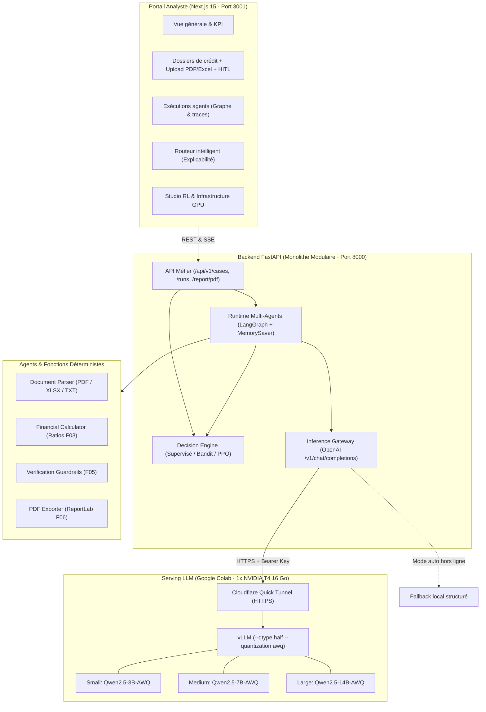
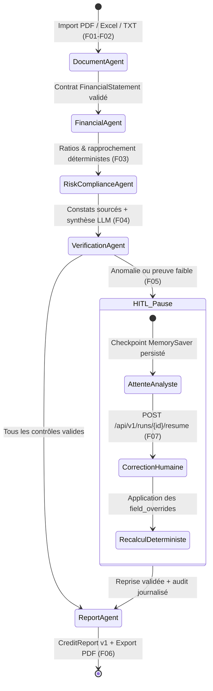
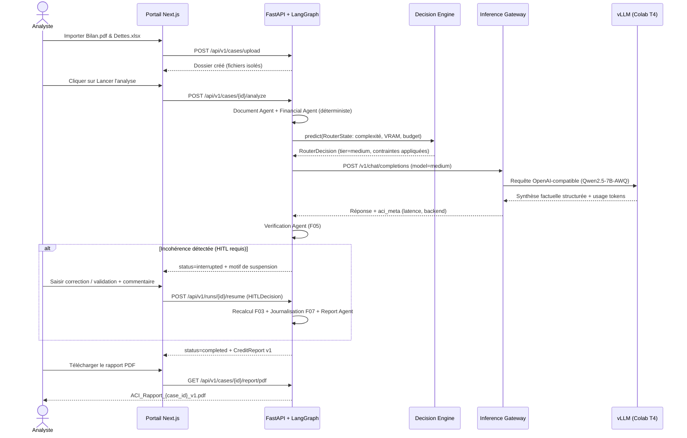
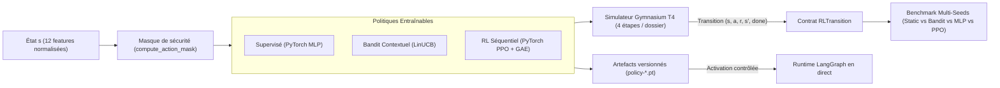
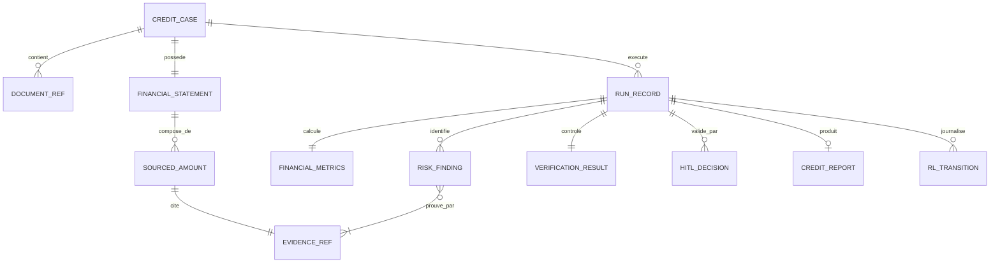

# Architecture Technique — Agentic Credit Intelligence (ACI)

> **Périmètre métier** : plateforme distribuée d'assistance à l'analyse financière des entreprises, **sans décision automatique de crédit**. Chaque valeur financière et chaque constat de risque est relié à une preuve documentaire vérifiable, tous les calculs sont déterministes et la validation finale appartient à l'analyste (HITL).

---

## 1. Architecture Globale Hybride (Local + Google Colab 1× NVIDIA T4)

ACI adopte une architecture modulaire permettant d'exécuter l'applicatif et l'orchestration localement tout en déportant l'inférence LLM sur un **GPU NVIDIA Tesla T4 (16 Go VRAM)** via **vLLM** et un tunnel HTTPS Cloudflare, avec bascule automatique sur un fallback local structuré hors ligne.

---

## 2. Workflow Multi-Agents LangGraph & Contrôle Humain (HITL)

Le graphe d'exécution garantit que **le routeur IA ne contourne jamais les calculs financiers ni les contrôles bloquants**. Lorsqu'une incohérence documentaire (ex. écart entre le bilan et `Dettes.xlsx`) ou une confiance d'extraction insuffisante est détectée, `Verification Agent` suspend l'exécution via `langgraph.types.interrupt()`.

---

## 3. Séquence d'Exécution de Bout en Bout

Ce diagramme détaille les échanges temps réel entre l'analyste, le portail Next.js, le runtime LangGraph, le Decision Engine et le serveur vLLM sur Colab T4.

---

## 4. Moteur de Décision Entraînable (PyTorch Supervisé, Bandit LinUCB & RL PPO)

Le moteur de décision apprend à optimiser le compromis **qualité / coût GPU / latence** sur le profil matériel **NVIDIA T4 (16 Go)** sans jamais décider de l'octroi de crédit.

- **Vecteur d'état normalisé (`STATE_DIM = 12`)** : type de tâche (one-hot × 4), taille du contexte, complexité estimée, charge GPU, VRAM T4, profondeur de file, budget restant, index d'étape, confiance précédente.
- **Masquage des actions interdites** :
  - `small` masqué si `complexité >= 0,80` sur tâche critique (`financial_extraction`, `risk_analysis`).
  - `large` masqué si `VRAM >= 90 %` ou `budget < 0,05 $`.
  - Contrôles documentaires toujours obligatoires.
- **Fonction de récompense** : `R = 0,60·Q − 0,15·C − 0,15·L − 0,10·E`.

---

## 5. Modèle de Données & Contrats Pydantic

Tous les agents manipulent des contrats strictement validés par Pydantic afin d'empêcher les erreurs d'unités (`UNIT` / `THOUSAND` / `MILLION`), les mélanges de devises ou les constats sans preuve.

---

## 6. Organisation du Dépôt

| Répertoire | Responsabilité |
| :--- | :--- |
| `apps/analyst-portal/` | Portail Next.js 15 (6 vues, bannière tapis marocain, upload PDF/Excel, export PDF) |
| `services/contracts/` | Contrats Pydantic partagés (`domain.py`, `intelligence.py`, `inference.py`) |
| `services/api/` | API FastAPI métier (`/cases`, `/upload`, `/analyze`, `/runs`, `/events` SSE, `/resume`, `/report/pdf`) |
| `services/runtime/` | Orchestration LangGraph (`StateGraph`, `MemorySaver`, `interrupt()`, traces) |
| `services/router/` | Service Decision Engine (`/router/predict`, `/training/jobs`) |
| `services/inference/` | Inference Gateway OpenAI-compatible (`/v1/chat/completions`, quotas, retry, fallback) |
| `agents/document/` | Parseur multi-formats (`.pdf`, `.xlsx`, `.txt`, `.csv`) et extraction sourcée |
| `agents/financial/` | Moteur de calculs financiers déterministes (ratios, DSCR, rapprochement dettes) |
| `agents/report/` | Générateur PDF bancaire versionné (ReportLab) |
| `intelligence/decision_model/` | Encodage d'état, masquage d'actions, MLP supervisé PyTorch, Bandit LinUCB |
| `intelligence/reinforcement_learning/` | Simulateur Gymnasium calibré T4 et entraîneur PPO PyTorch |
| `datasets/synthetic/` | Générateur reproductible de dossiers annotés & vérité terrain |
| `benchmarks/` | Protocole expérimental multi-seeds (`Static` vs `Bandit` vs `Supervised` vs `PPO`) |
| `infrastructure/colab/` | Notebook Google Colab prêt à l'emploi pour vLLM sur 1× NVIDIA T4 (16 Go) |
| `tests/` | Suite complète `pytest` (26 tests unitaires et d'intégration) |
